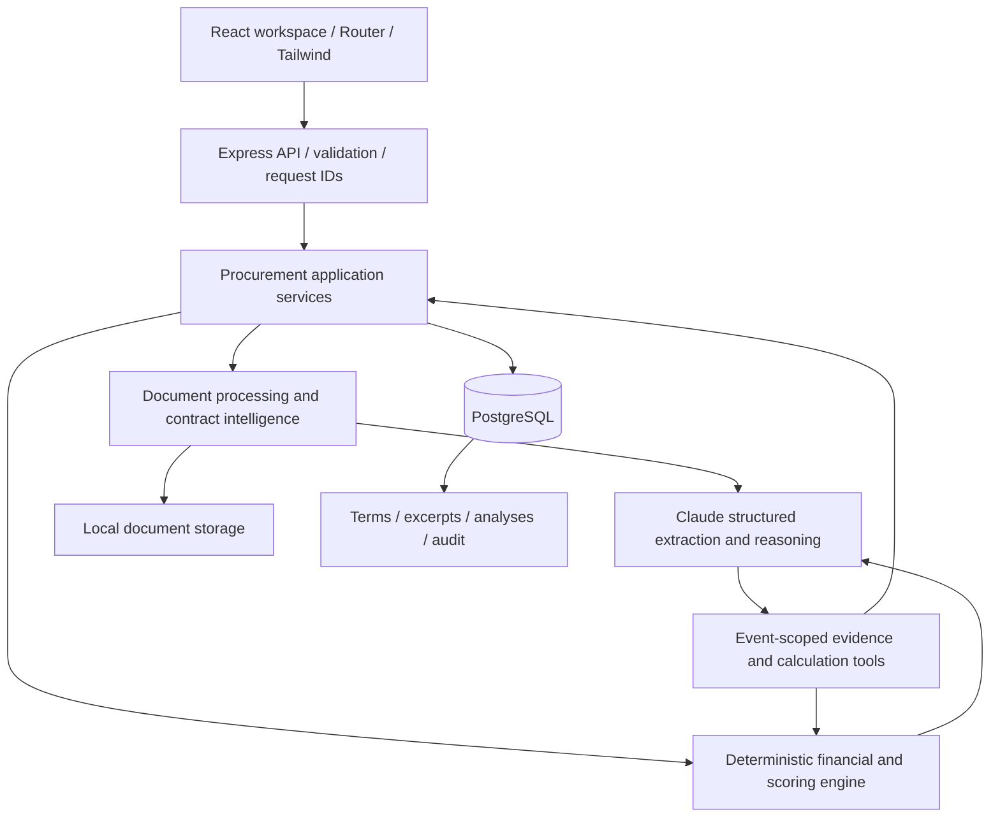

# Legal & Procurement Intelligence

AI-assisted procurement and contract decision support built with React, TypeScript, Express, PostgreSQL and the official Anthropic SDK. The workspace helps a reviewer answer: **Which supplier offers the best overall commercial position, what risks remain, and what should we negotiate before signing?** It is a local modular monolith, not a chat interface, and it does not provide legal advice.

## Local setup

Requires Node.js 22.12+ (tested with 24), npm, and Docker with Compose. From this directory:

```sh
cp .env.example .env
# Add ANTHROPIC_API_KEY in .env for actual extraction and analysis.
npm ci
docker compose up -d --wait
npm run db:migrate
npm run db:seed
npm run dev
```

Open [the procurement workspace](http://127.0.0.1:5173). API: [health](http://127.0.0.1:3001/api/health).

The database remains in the Docker named volume after shutdown. `docker compose stop` stops it without deleting data. Seed is idempotent and does not overwrite an existing demo event. Migrations are tracked and protected by a PostgreSQL advisory lock.

**Local database:** Compose publishes PostgreSQL on **5433** to avoid a local service on 5432. Set `POSTGRES_PORT` and the corresponding `DATABASE_URL` together to change the host port. Start Docker Desktop before running Compose. See [VERIFICATION.md](VERIFICATION.md) for the current checkpoint and live-AI blocker.

### Environment

| Variable | Purpose |
| --- | --- |
| `ANTHROPIC_API_KEY` | Required when invoking extraction, analysis or scenario explanation; never sent to React |
| `ANTHROPIC_MODEL` | Structured-output capable Claude model; default `claude-sonnet-4-6` |
| `DATABASE_URL` | PostgreSQL connection string; Compose default host port 5433 |
| `POSTGRES_PORT` | Docker host port, default 5433; must agree with `DATABASE_URL` |
| `PORT` | API port, default 3001 |
| `FRONTEND_URL` | Allowed browser origin, default `http://localhost:5173` |
| `DOCUMENT_STORAGE` | Runtime uploads relative to project root, default `storage` |

Restart the backend after changing `.env`, including adding the API key.

Vite forwards `/api` to port 3001. Update its proxy if you change the API port. Both development servers bind to loopback. `.env`, uploads, logs and build outputs are ignored by Git.

Individual commands:

```sh
npm run dev -w backend
npm run dev -w frontend
npm run build
npm run start -w backend
```

The build compiles Express and bundles React. There is no deployment infrastructure.

## Business problem and workflow

Lowest starting price can conceal compounding escalation, restrictive exit rights, liability exposure or weak operational commitments. Legal and procurement reviewers need comparable terms, transparent calculations and defensible commercial reasoning.

1. Create an event and set requirements and weights.
2. Add suppliers and upload contracts, proposals, pricing schedules or SLA documents.
3. Process text and extract normalised terms with Claude.
4. Inspect source excerpts, missing fields and conflicts.
5. Compare financial projections, weighted scores and requirement deviations.
6. Run Claude analysis to interpret trade-offs, qualitative risks and negotiation potential.
7. Inspect the evidence-backed recommendation and negotiation playbook.
8. Model hypothetical changes; optionally ask Claude to explain recalculated implications.
9. Record a human decision, rationale and whether negotiation remains necessary.

All visible workflow actions call real API endpoints. No recommendation or qualitative risk list is seeded or manufactured when an API key is missing.

## Architecture



`backend/src` contains focused modules: API (`app.ts`), persistence (`db.ts`), domain orchestration (`procurement.ts`, `analysis.ts`), document pipeline (`documents.ts`), calculations (`financial.ts`), validation (`schemas.ts`) and Anthropic transport (`ai.ts`). `frontend/src` contains the functional routed workspace. No microservices, vector database, Redis, agent framework or cloud dependencies are needed.

## Domain and persistence

PostgreSQL is the source of truth. Relational foreign keys link:

- Procurement events, requirements and evaluation criteria.
- Suppliers, documents, source chunks and contract terms.
- Supplier metrics and deterministic evaluations.
- Versioned analyses, qualitative risks, negotiation opportunities and analysis evidence.
- Human decisions and audit events.

Flexible requirements, normalised values and structured AI outputs use JSONB; entity relationships and evidence ownership remain relational. Analyses store the model, event revision, workflow trace and timestamp. Changing requirements, adding or editing suppliers, uploading documents or re-extracting terms increments the event revision. Old analysis is visibly marked stale, and an acceptance referencing stale analysis is rejected. Historical decisions and analyses remain stored.

Analysis results, risk records, opportunities and evidence links are committed in one transaction. An event revision check rejects an analysis generated over changing inputs. Seed data is atomic and reproducible. Financial metrics/evaluations are persisted when comparison runs.

## Documents and contract extraction

Uploads support text-bearing PDF, DOCX and UTF-8 TXT, up to 10 MB. Extension/MIME agreement and file signatures are checked; server-generated filenames prevent user paths from controlling storage. Files are local, with metadata and extracted text in PostgreSQL. PDF text uses `pdf-parse`; DOCX uses `mammoth`. Scanned PDFs without text require OCR before upload.

Text is chunked into bounded sections with line/character locations. Claude sees a maximum of three 6,000-character chunks per extraction request, not an entire collection. Each extracted fact includes its document, chunk, location, verbatim excerpt, confidence, value and unit. The Zod model covers pricing, payment, duration/renewal, cancellation, escalation, SLA, warranty, liability, support and breach consequences. Absent values stay null/unknown. Contradictory values across documents become unknown and are listed as conflicts rather than silently resolved.

The validator rejects nonexistent source chunks, excerpts absent from source text, negative numeric facts, out-of-range percentages and invalid output types. Extraction supersedes a document's current terms transactionally only after all chunks pass validation. Superseded terms retain their IDs and source excerpts for historical analysis references; comparisons use only active terms. The terms API defaults to current facts; `?history=1` also returns superseded evidence. Failures retain previous terms and a useful document status; interrupted extraction is marked retryable on server restart.

Seeded documents are intentionally labelled `seed-reviewed`: their terms are curated sample facts with exact excerpts, **not AI-generated output**. Click **Extract with Claude** to exercise real extraction. Extraction confidence is the model's self-reported confidence and is not a calibrated probability.

## Financial engine and scoring

Calculations run exclusively in TypeScript. Claude receives computed results and cannot supply numerical evaluation scores.

```text
Year n recurring cost = annualPrice × (1 + escalationPercent / 100)^(n − 1)
Projected total = sum(rounded annual recurring costs) + one-time setup fee
Escalation impact = recurring projection − annualPrice × years
Cost difference = projected total − least comparable supplier total
Percentage difference = cost difference / least comparable total × 100
```

Initial contract value uses contract duration with pro-rated final years. The projection horizon is independent of initial term and assumes continued service at the same escalation structure; renewal terms must still be reviewed. Monetary outputs are rounded to cents; the UI displays rounded rand amounts. Payment days are compared as liquidity terms, without inventing a financing rate or cash-flow saving.

Only evidenced ZAR prices are aggregated. Missing annual cost, escalation or setup fee prevents a total. Tax, discounting, optional charges, uncertain penalties and credits are excluded rather than guessed. The application does not support FX conversion or net present value.

Criterion weights are event data, must total 100%, and must cover six unique categories. Scores are transparent domain rules, capped at 100:

| Criterion | Rule |
| --- | --- |
| Cost | Lowest comparable projected total / supplier projected total × 100 |
| Flexibility | Mean of cancellation target / actual notice and actual / preferred payment period |
| SLA | Allowed downtime target / supplier downtime × 100; capped at 100 when requirement is met |
| Liability | Actual cap months / minimum cap months × 100 |
| Warranty | Actual duration / minimum duration × 100 |
| Support | 100 for required continuous support; 40 for evidenced restricted hours; 100 when continuous support is not required |

If a weighted criterion lacks evidence, the overall score is null. Missing information is not awarded points. SLA scoring compares downtime rather than dividing near-identical availability percentages: 99.5% availability permits five times the downtime of 99.9% and receives a score of 20 against that requirement. Support's 40 is an explicit rubric convention, not a model prediction. These rules are intentionally narrow; cancellation conditions, exclusions, response guarantees, caps on credits and indemnities remain qualitative review matters.

Budget, escalation, SLA, cancellation, warranty, payment, liability and support deviations are displayed separately. A score does not establish supplier eligibility or override an important requirement.

## Claude reasoning and tool use

The official Anthropic TypeScript SDK sends JSON Schema structured outputs through `output_config.format` using its Zod helper ([Anthropic structured-output documentation](https://platform.claude.com/docs/en/build-with-claude/structured-outputs)). The model receives event requirements/weights, normalised supplier terms, calculations, deviations, scores and source evidence. It returns validated objects for:

- Recommendation, confidence and key reasons.
- Per-supplier strengths, weaknesses, commercial position and alignment.
- Pairwise trade-offs and decision factors.
- Qualitative risks, impact, mitigation and evidence references.
- Negotiation opportunities with current position, proposed target and fallback.
- Negotiation playbook with leverage, concessions, sequencing and concession logic.
- Supporting claims labelled fact, interpretation or recommendation, and limitations.

The bounded Messages loop allows eight model rounds. It dispatches real application tools:

| Tool | Real operation |
| --- | --- |
| `get_supplier_profile` | Current event supplier's terms, financials and evaluation |
| `get_procurement_requirements` | Event requirements and stored criteria |
| `get_contract_evidence` | Exact persisted term/source excerpt |
| `calculate_projected_cost` | Deterministic projection with explicitly hypothetical overrides |

Tools cannot access suppliers or evidence outside the current event. Every tool input is validated. The reasoning prompt asks Claude to inspect supporting evidence and calculate a relevant negotiation scenario before finalising. The tool trace records selected tools, arguments, duration and token use. There are no fake tools or precomputed model responses in the application.

Output validation rejects unknown supplier IDs, missing/duplicate supplier assessments, same-supplier trade-offs, nonexistent evidence and cross-supplier evidence claims. The recommendation must have supplier-specific supporting evidence. All risk/opportunity references and playbook evidence must exist. Source identity checks cannot prove that every natural-language interpretation is correct: human review against the full document is essential.

The model is explicitly instructed to treat document text as untrusted data, distinguish unknowns, avoid unsupported legal conclusions and avoid selecting solely on price. Truncated, refused, invalid or failed API responses never become analyses. Missing credentials return HTTP 503; malformed model responses/API failures return 502.

## Risk and negotiation intelligence

The risk list is generated by Claude from real terms and deviations. It is not a hardcoded business result. Risks include severity, explanation, impact, mitigation and source term references. Negotiation opportunities distinguish evidenced current terms from **proposed** targets/fallbacks; they do not claim supplier agreement or invented market leverage.

The playbook provides opening actions, priority issues, requested concessions, fallbacks, commercial rationale, risks to avoid and a suggested sequence. The workspace renders the entire structured result and allows reviewers to expand its references. No emails, contract signatures or external negotiations are executed.

## What-if analysis

The backend clones the event's structured inputs and recalculates comparison using proposed annual cost, escalation, cancellation notice or SLA, plus optional requirement overrides. It does not change submitted facts or evidence. The UI supports requirement-only changes as well as proposed supplier terms. An optional separate Claude request explains the calculated scenario and its limitations. The audit records assumptions and cost delta.

For the demo, reducing Supplier B escalation from 8% to 5% reduces five-year projected cost by **R716,036.39**, holding setup fees and all other terms constant. This is a calculation, not a claim that Supplier B agreed to reduce its price.

## Demonstration trade-offs

The six repository documents use Supplier A, Supplier B and Supplier C without fictional branding:

- A: mid-range initial price and stronger liability than B, but limited support, weaker uptime/warranty and qualified cancellation.
- B: lowest initial price, 60-day payment, stronger SLA and shorter notice, but 8% escalation, a six-month liability cap, auto-renewal, early exit charges and exclusive-remedy credits.
- C: stronger uptime, warranty and liability protections, but highest initial cost, budget deviation and longer cancellation notice.

No winner is seeded. Initial facts trace to `documents/sample` clauses. Financial scores are computed; overall recommendations and negotiation reasoning require actual Claude access.

## API surface

All IDs are UUIDs; JSON/input errors receive meaningful HTTP status codes.

| Method | Endpoint | Purpose |
| --- | --- | --- |
| GET | `/api/health` | PostgreSQL health and AI configuration flag |
| GET / POST | `/api/procurement-events` | List/create events |
| GET / PUT | `/api/procurement-events/:id` | Read/update requirements and weights |
| GET / POST | `/api/procurement-events/:id/suppliers` | List/add suppliers |
| GET / PUT | `/api/suppliers/:id` | Supplier detail / edit name and description; invalidates analysis |
| GET / POST | `/api/suppliers/:id/documents` | List/upload; multipart field `file` and optional `documentType` |
| GET | `/api/documents/:id` | Processed source text/chunks |
| GET | `/api/documents/:id/download` | Original document |
| POST | `/api/documents/:id/extract` | Real Claude extraction |
| GET | `/api/procurement-events/:id/terms` | Normalised terms and sources |
| GET | `/api/procurement-events/:id/comparison` | Deterministic financials, scores and deviations |
| POST | `/api/procurement-events/:id/analyse` | Claude tools, recommendation, risks and playbook |
| GET | `/api/procurement-events/:id/analysis` | Latest analysis and stale flag |
| GET | `/api/procurement-events/:id/risks` | Latest persisted qualitative risks |
| GET | `/api/procurement-events/:id/negotiations` | Latest persisted opportunities |
| GET | `/api/procurement-events/:id/evidence` | Persisted analysis claims/excerpts |
| POST | `/api/procurement-events/:id/what-if` | Scenario recalculation and optional explanation |
| POST | `/api/procurement-events/:id/decision` | Human accept/reject/defer decision |
| GET | `/api/procurement-events/:id/decisions` | Decision history |
| GET | `/api/procurement-events/:id/audit` | Recent audit trail |

## Tests and verification

```sh
npm test                         # Unit tests; no credentials or DB required
npm run build                    # Both TypeScript projects + production frontend bundle
npm run verify                   # Real PostgreSQL/API workflow; seed first
TEST_DATABASE=1 npm test          # PostgreSQL analysis persistence with mocked Claude transport
VERIFY_REAL_AI=1 npm run verify   # Actual Claude extraction + tools + analysis + persistence
npm run evaluate                 # Evaluate latest real demo analysis
EVALUATE_REAL_AI=1 npm run evaluate # Generate and evaluate an actual analysis
```

Unit tests cover compounding/rounding, invalid inputs, negotiation savings, missing/contradictory data, weights, SLA downtime scoring, extraction evidence validation, risk/opportunity schemas, event-scoped tools, malformed Claude outputs, truncation and tool-loop behavior. Anthropic transport is mocked **only in tests**.

`npm run verify` uses the Express application with Supertest and real PostgreSQL. It creates a temporary event, uploads a real sample document, validates source traceability, persists evaluation data, runs scenarios and records a decision/audit. It starts a temporary API on port **3002**, reads documents/decisions/comparison through two independent server processes to check restart persistence, then deletes its temporary relational data and uploaded files. Keep port 3002 free when verifying. When no key is configured, it verifies the clear missing-key errors and explicitly reports that real AI was skipped. Database tests use isolated temporary events and test-only mocked Anthropic transport, then remove their fixtures. They check successful re-extraction with existing historical evidence, stale-approval rejection and retention of valid facts after a failed extraction.

`VERIFY_REAL_AI=1` incurs API usage and re-extracts all six demo documents before running analysis. It checks that real tool calls occurred and analysis evidence was stored. It does not silently substitute a mock if the key or API is unavailable. The evaluation runner checks escalation risk/negotiation, premium-price/protection trade-offs, grounded recommendations and actual tool use; failures return a nonzero exit code. These are focused heuristic evaluations, not calibrated measures of legal correctness.

### Manual end-to-end review

Open the demo, inspect comparison, documents and source facts. Extract each document, run Claude analysis, inspect its tools/risks/playbook/evidence, calculate a scenario, and record a human decision. Reload or restart the API and confirm the same persisted analysis and decisions remain. Edit requirements and verify the existing analysis becomes stale.

## Security, observability and limitations

This is a single-user loopback development application. There is no login, tenancy or role system; do not expose it to a network or use it as a production legal system. SQL is parameterised, body/file limits are enforced, browser mutation origins are restricted, CORS is scoped, Helmet sets response headers and uploaded files get safe generated names. CORS itself is not authentication. Uploaded source material and derived facts are stored unencrypted on the local machine. Actual Claude operations transmit document text and procurement context to Anthropic; use demonstration data or suitably authorised material.

Logs record request IDs, route/status/duration, AI workflow duration/token counts and failure types; API keys and document bodies are not logged. Audits preserve uploads, extraction outcomes, analyses/tool traces, scenarios, changes and decisions. There is no external telemetry platform.

Long AI work is synchronous; this avoids unnecessary queue infrastructure but has finite model/time/round limits. OCR, spreadsheets, encrypted PDFs, multi-currency conversion, advanced table reconstruction, clause precedence, sophisticated financial modelling and production access control are outside this version. Evidence validation protects provenance, not the truth of every model interpretation. An extractor may still misread a qualified clause; reviewers must inspect exact source text and unresolved conflicts. Model configuration/access can change and requires a supported structured-output model.

This application demonstrates a deliberate boundary: software calculates, Claude interprets and proposes, PostgreSQL records, and the human reviewer decides.
